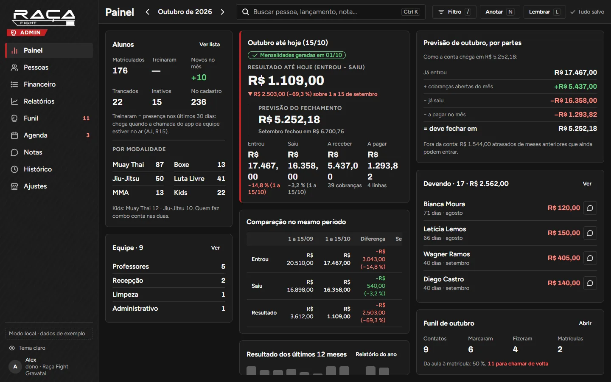
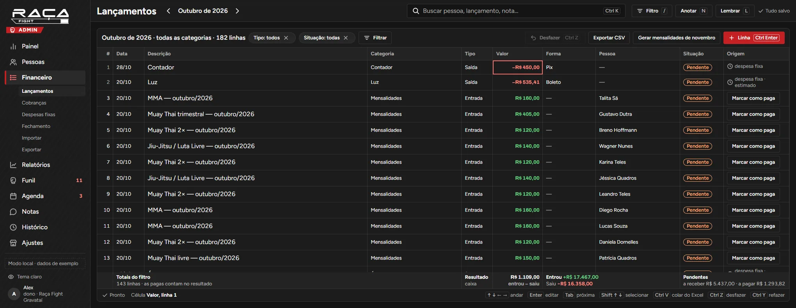

# Raça Fight

App de academia de luta em três partes: o app do aluno, o app da equipe (professor e recepção) e o Admin do dono, com financeiro "tipo planilha".

**Estado:** parado (desde out/2026), esperando respostas da academia. Última mudança no código: 18/10/2026 (`22d690c`); em 27/11/2026 só mudou o destino do PDF das apresentações.

## Prints






Tirados em 27/11/2026 da versão construída (`admin/dist` e `app/dist-entrega`), em modo local com os dados de exemplo (nomes inventados).

## O que tem pronto

- **Admin** (`admin/`, Vite + React, PWA): painel, pessoas (alunos, responsáveis dos Kids, funcionários), financeiro com planilha pelo teclado (colar do Excel, desfazer, fechar o mês, importar XLSX, exportar CSV), cobranças, despesas fixas, relatórios, funil, agenda, notas e histórico. Roda em modo local com dados no navegador (IndexedDB).
- **App** (`app/`, Expo SDK 54): entrada com "Sou aluno" e "Sou da equipe", check-in, horários, faixa, turmas Kids, treino sem sinal. Grava no aparelho (SQLite / armazenamento do navegador).
- **Domínio compartilhado** (`app/dominio/`): regras de treino, cronômetro, avisos e o motor financeiro, com testes em `node --test`.
- **Banco desenhado**: esquema único em `app/supabase/migrations/` (49 tabelas com RLS). Foi testado só em PGlite; **não existe projeto Supabase criado**.
- **APK Android** gerado localmente em 18/10/2026 (assinado com chave de debug, serve para teste, não para a Play).
- **Três PDFs de apresentação** (Admin, Professor, Aluno), refeitos por `docs/apresentacao/{admin,professor,aluno}/` (capturar → montar → folhear).
- Números de teste da última rodada (relatórios AN e AO em `docs/revisao/`): 500 de domínio, 109 de tela, 40 Vitest e e2e no Admin e no app. NÃO FOI POSSÍVEL VALIDAR agora: não rodei os testes ao escrever este README.

## Onde parou e próximo passo

Parou depois da entrega de 18/10/2026 (onda 5 em `docs/coordenacao.md`). Está esperando da academia:

- o logo em vetor (ícone do app, abertura, cabeçalho);
- a planilha que eles usam hoje, para importar e conferir no Admin;
- o nome do app na loja e o identificador do pacote;
- regras abertas: janela do check-in, faixas de Muay Thai e Luta Livre, alunos de 16–17 anos, destino da dieta e do plano Plus.

Próximo passo quando essas respostas chegarem: atualizar `00-prompts/P00-CONTEXTO.md` e `docs/decisoes.md`, criar o projeto no Supabase e ligar o Admin e o app nele (passos em `admin/LEIA-ME.md`). O site público da academia é outro repositório.

## Como rodar

Precisa do Node 24.

```bash
# Admin (app do dono)
cd admin
npm install
npm run dev          # http://localhost:5174
npm run abrir        # monta, sobe a prévia em http://localhost:4174 e abre no navegador
npm run testar       # Vitest
npm run testar:e2e   # Playwright

# App do aluno e da equipe
cd app
npm install
npm run web              # no navegador do PC
npm run iniciar:expo-go  # no celular, pelo Expo Go
npm run testar           # domínio + telas
npm run exportar:web     # versão web estática
```

Sem `.env.local`, os dois abrem em modo local com dados de exemplo. `?hoje=2026-10-15&tema=escuro` no endereço do Admin fixa o dia e o tema (útil para prints).

## Stack e pastas

Expo + React Native + TypeScript (app), Vite + React + TypeScript (Admin), Supabase (Postgres + RLS) desenhado e ainda não ligado.

```
00-prompts/        P00 (contexto e pendências) até P13: cada prompt refaz uma parte
01-especificacao/  o que o app faz, sem código (papéis, histórias, fluxos, regras)
02-design/         sistema de design, marca, referências, ícones, anatomia
03-arquitetura/    stack, modelo de dados, decisões técnicas
admin/             o Admin do dono (Vite + React, PWA)
app/               o app do aluno e da equipe (Expo) + dominio/ + supabase/
docs/              decisoes.md, coordenacao.md (ondas), revisao/ (relatórios), apresentacao/ (PDFs), hospedagem/, prints/
```

O projeto começou como "Academia Plus" (academia de musculação) e virou academia de luta em 15/10/2026. O `LEIA-ME.md` da raiz é o retrato dessa primeira fase; as regras do repositório ficam no `CLAUDE.md`. Créditos de imagens e ícones em `02-design/imagens/` e `02-design/icones/CREDITOS.md`.
