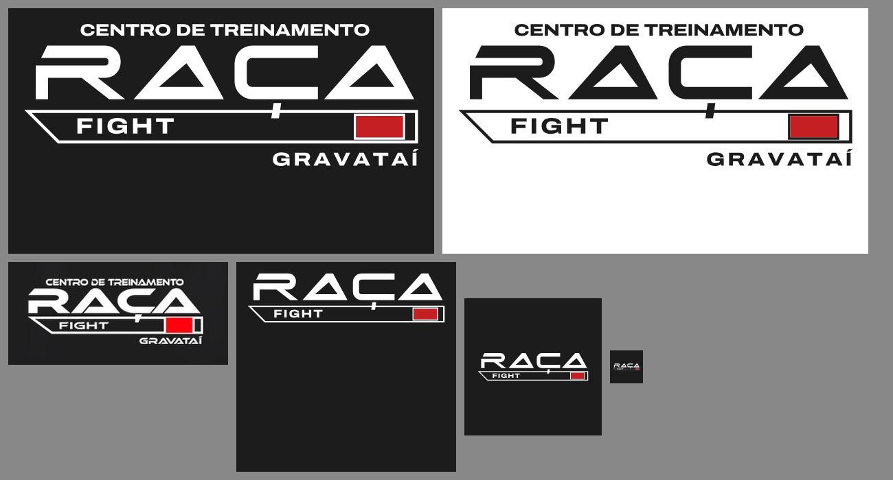
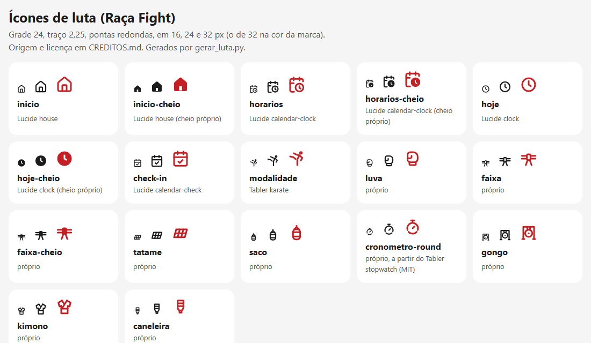
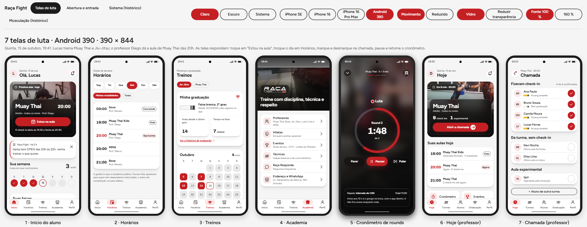
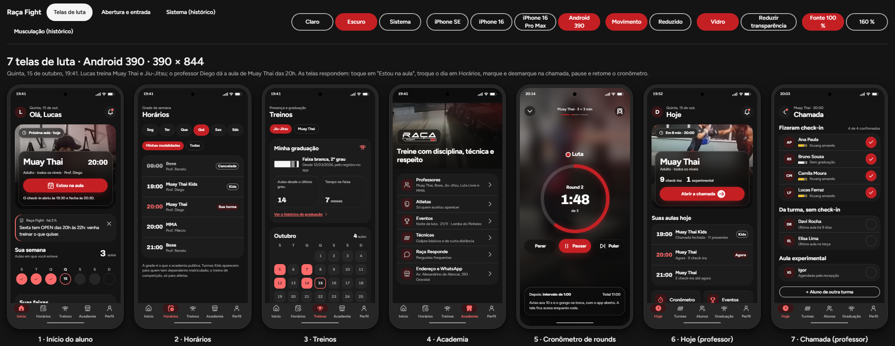
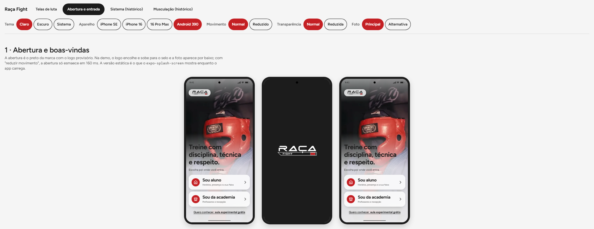

# AL — Cara de luta (Raça Fight): marca, logo, fotos, ícones e telas

> Agente AL, P12, 15/10/2026. Escreveu só em `02-design/` e neste relatório. Não mexeu em `app/`, `01-especificacao/` nem `docs/apresentacao/`. Não desenhou o app Admin (é do AK).

## Resumo

- **Tokens 1.8.0 → 2.0.0**: o verde do Academia Plus saiu; entrou o vermelho `#C42024`, o preto `#1C1C1C` / `#343434` e o branco, com os tons de apoio do claro e do escuro. Todos os pares medidos passam. Os nomes dos papéis não mudaram, então o gerador do app segue igual.
- **Logo PROVISÓRIO** em SVG, refeito a partir das fotos. Tem a versão completa, a compacta, a de uma cor, o ícone do app e a imagem da abertura em PNG.
- **Fotos**: 15 usos escolhidos das 54 (27 recortes, 100 arquivos, cerca de 1,1 MB) e o índice. As fotos com criança ficam marcadas "só com autorização".
- **17 ícones de luta**, de Lucide (ISC), de Tabler (MIT) e de desenho próprio. Os de musculação saem do design, mas os arquivos ficam no lugar até o AM tirar o catálogo de musculação.
- **Telas**: `luta.html` novo, com 7 telas (5 do aluno e 2 do professor). `entrada.html` foi adaptado. As telas antigas ficam marcadas como histórico, já com as cores novas.
- **`auditar.mjs`: 0 achados** nas minhas páginas e nas antigas (mockup, entrada, novas, luta, logo), incluindo a janela de 2040 × 790. Os 12 achados restantes da rodada final estão no `admin.html`, que é do AK e entrou na auditoria durante a onda (ver a seção 7).

## 1. O que mudou (arquivos)

| Onde | O quê |
|---|---|
| `02-design/sistema-de-design/tokens.json` | 2.0.0. Antes de mudar, o antigo foi guardado inteiro em `sistema-de-design/historico/tokens-1.8.0-academia-plus.json`. O `$historico`, o `$descricao` e o `cor.$contrato` explicam a troca. |
| `sistema-de-design/raca-fight/` | `paleta.mjs` (a fonte das cores e a medida de contraste) → `contraste.json`; `aplicar-paleta.mjs` (passou a paleta para o tokens.json e os CSS, uma vez só); `montar-mockups.mjs` (monta o sprite e o controle de página nos mockups de luta); `capturas/` (os prints deste relatório) |
| `sistema-de-design/mockups/sistema.css`, `novas.css`, `entrada.css`, `index.html`, `novas.html` | recoloridos por variável e por tema. Em `novas.css`, três ajustes de contraste: o número do modo treino e o "Desfazer" passaram a `marca`, e o destaque da comemoração ganhou fundo preto. |
| `sistema-de-design/mockups/luta.html` + `luta.css` | novos (a seção 6) |
| `sistema-de-design/mockups/entrada.html` + `entrada.css` | adaptados (a seção 6) |
| `sistema-de-design/auditoria/auditar.mjs` | mede também a página `luta`, conhece as abas novas e trata as linhas da aba Academia e da grade como superfície (a seção 7) |
| `sistema-de-design/01-TOKENS.md`, `marca-e-proposta/02-IDENTIDADE-VISUAL.md`, `03-LOGO.md` | uma nota no topo de cada um: "superado para a Raça Fight", com o caminho do que vale agora |
| `marca-e-proposta/logo-raca-fight/` | o logo provisório (a seção 3) |
| `imagens/raca-fight/` | as fotos por uso e o `00-INDICE.md` (a seção 4) |
| `icones/luta/` | os ícones de luta, o sprite, a galeria e o `CREDITOS.md` (a seção 5) |

## 2. A paleta e o contraste

A marca medida nas fotos foi o vermelho `#C42024` (tirado da grade de horários), o preto `#1C1C1C` e o grafite `#343434` (os fundos dos cartazes) e o branco. O resto são os tons de apoio.

O ponto de projeto: **o vermelho cru não serve como texto no escuro**. Ele dá 2,90 : 1 sobre `#1C1C1C` e 2,12 : 1 sobre `#343434`. Por isso a paleta ficou assim:
- **`viva` = `#C42024` nos dois temas**: é o preenchimento (botão primário, "Estou na aula", a chamada marcada, o cronômetro em luta, a comemoração), sempre com o texto branco por cima (5,87 : 1).
- **`marca`**: no claro é o mesmo `#C42024` (texto, link, aba ativa). No escuro, `marca`, `progresso` e `foco` usam o **vermelho claro `#FF6B6B`**, que dá 6,14 : 1 sobre `#1C1C1C`.
- **O erro é da mesma família do vermelho** (`#B3261E` no claro, `#FF8A80` no escuro). Por isso vale a regra que ficou no `cor.$contrato`: o erro aparece sempre com o ícone de alerta e a frase, e o vermelho da marca nunca aparece sozinho como mensagem de estado.
- O dourado do Plus fica como estava, parado, porque o Plus é [decidir] (L12).
- A **abertura** é o preto da marca com o logo branco, igual nos dois temas.
- Vidro, foto, véu da entrada, gráfico, mapa e ilustração passaram para cinzas neutros (o cinza esverdeado saiu) e para o brilho vermelho.
- O `cronometro.fase.trabalho` passou de `marca` para `viva`, para continuar sendo vermelho cheio no escuro.

| Tema | Par | Cores | Razão | Mínimo |
|---|---|---|---|---|
| claro | texto sobre fundo | `#1C1C1C` / `#F5F5F5` | 15,63 : 1 | 4,5 |
| claro | texto sobre superficie | `#1C1C1C` / `#FFFFFF` | 17,04 : 1 | 4,5 |
| claro | textoSecundario sobre fundo | `#545454` / `#F5F5F5` | 6,95 : 1 | 4,5 |
| claro | textoSecundario sobre superficie | `#545454` / `#FFFFFF` | 7,57 : 1 | 4,5 |
| claro | marca sobre superficie | `#C42024` / `#FFFFFF` | 5,87 : 1 | 4,5 |
| claro | marca sobre fundo | `#C42024` / `#F5F5F5` | 5,38 : 1 | 4,5 |
| claro | vivaTexto sobre viva (e marcaTexto sobre marca) | `#FFFFFF` / `#C42024` | 5,87 : 1 | 4,5 |
| claro | marca sobre marcaSuave | `#C42024` / `#FBE6E6` | 4,91 : 1 | 4,5 |
| claro | texto sobre marcaSuave | `#1C1C1C` / `#FBE6E6` | 14,25 : 1 | 4,5 |
| claro | progresso sobre trilho | `#C42024` / `#E2E2E2` | 4,53 : 1 | 3 |
| claro | foco sobre fundo | `#C42024` / `#F5F5F5` | 5,38 : 1 | 3 |
| claro | erro sobre superficie / erroTexto sobre erro | `#B3261E` / `#FFFFFF` | 6,54 : 1 | 4,5 |
| claro | sucesso sobre fundo | `#0A7E3A` / `#F5F5F5` | 4,75 : 1 | 4,5 |
| claro | atencao sobre fundo | `#B74D00` / `#F5F5F5` | 4,73 : 1 | 4,5 |
| escuro | texto sobre fundo | `#F5F5F5` / `#141414` | 16,90 : 1 | 4,5 |
| escuro | texto sobre superficieElevada | `#F5F5F5` / `#262626` | 13,88 : 1 | 4,5 |
| escuro | textoSecundario sobre fundo / superficie / elevada | `#ADADAD` / `#141414` · `#1C1C1C` · `#262626` | 8,21 · 7,59 · 6,74 : 1 | 4,5 |
| escuro | marca sobre fundo / superficie / elevada | `#FF6B6B` / `#141414` · `#1C1C1C` · `#262626` | 6,64 · 6,14 · 5,45 : 1 | 4,5 |
| escuro | marcaTexto sobre marca | `#1C1C1C` / `#FF6B6B` | 6,14 : 1 | 4,5 |
| escuro | vivaTexto sobre viva | `#FFFFFF` / `#C42024` | 5,87 : 1 | 4,5 |
| escuro | marca sobre marcaSuave | `#FF6B6B` / `#3A1517` | 5,82 : 1 | 4,5 |
| escuro | texto sobre marcaSuave | `#F5F5F5` / `#3A1517` | 14,82 : 1 | 4,5 |
| escuro | progresso sobre trilho | `#FF6B6B` / `#2E2E2E` | 4,89 : 1 | 3 |
| escuro | foco sobre fundo | `#FF6B6B` / `#141414` | 6,64 : 1 | 3 |
| escuro | erro sobre superficie / erroTexto sobre erro | `#FF8A80` / `#1C1C1C` · `#141414` / `#FF8A80` | 7,47 · 8,07 : 1 | 4,5 |
| escuro | sucesso / atencao sobre superficie | `#67D283` · `#FDA16B` / `#1C1C1C` | 9,03 · 8,51 : 1 | 4,5 |
| (marca crua) | vermelho sobre o preto / o grafite | `#C42024` / `#1C1C1C` · `#343434` | **2,90 · 2,12 : 1** | não é texto |

Todos os pares estão em `raca-fight/contraste.json`. Para medir de novo, rode `node raca-fight/paleta.mjs`, que termina com código 1 se algum par cair abaixo do mínimo.

**Sobre foto e vidro, o contraste é medido no pior pixel** pela auditoria (19 mil medições na rodada final). Para passar nessa medida, a foto da entrada ganhou um tratamento por tema: escurecida no escuro, porque o capacete vermelho apagava o título com a fonte a 160 %, e clareada no claro. É o mesmo método das fotos da entrada do agente O. O topo da aba Academia ganhou um véu que fecha mais cedo, porque a janela clara do salão ficava atrás do título.

## 3. O logo PROVISÓRIO

Está em `02-design/marca-e-proposta/logo-raca-fight/`, com o `00-LEIA-ME.md` marcado como PROVISÓRIO. Ele vale até chegar o arquivo original da academia.

- **Fontes usadas**: `raca-37` (o rodapé da grade), `raca-01` (o letreiro na parede) e a foto de perfil.
- **"RAÇA"**: desenhado à mão em geometria. O R é aberto em cima, os dois A são triângulos com o miolo triangular e a cedilha do Ç cai dentro da faixa.
- **"FIGHT", "CENTRO DE TREINAMENTO" e "GRAVATAÍ"**: escritos em Archivo (SIL OFL 1.1, a licença está junto) na largura 125 e no peso 800, convertida em contorno.
- **A faixa**: a ponta esquerda tem o corte em diagonal e a ponta da direita é vermelha.
- **Arquivos**:
  - SVG: completo, nas versões claro e escuro; compacto, nas versões claro e escuro; compacto de uma cor; ícone do app em 1024; primeiro plano do ícone adaptativo do Android.
  - PNG em `png/`: o ícone, a imagem da abertura para o `expo-splash-screen` (fundo transparente sobre o `#1C1C1C`) e o completo em 1600 px para o PDF.
- **Gerador**: `fonte/gerar_logo.py`.
- **Onde aparece**: nos mockups, o compacto é o `<symbol id="s-simbolo">`. A ponta vermelha vem pela variável `--logo-ponta`. O logo aparece na abertura (240 pt), no selo de vidro das boas-vindas (96 pt) e no topo da aba Academia.

## 4. As fotos escolhidas

O índice completo está em `02-design/imagens/raca-fight/00-INDICE.md`, que traz o porquê de cada escolha, a lista "só com autorização" e as fotos que ficaram de fora. O gerador é `gerar.py` e os recortes estão no `manifesto.json`.

| Uso | Foto | Observação |
|---|---|---|
| Abertura e entrada (tela cheia) | `raca-54` | o capacete vermelho sobre o kimono, **sem rosto**, com versão escura, clara e desfocada |
| Fundo e herói do Início | `raca-14` | as mãos amarrando a bota vermelha |
| Aula (Hoje do professor) | `raca-09` | sparring no tatame, adultos ao longe |
| Muay Thai · Boxe · Jiu-Jitsu/Luta Livre · MMA | `raca-40` · `raca-20` · `raca-54` · `raca-02` | o cartão de 358 × 200 e a miniatura de 96 |
| Kids e Graduação | `raca-11` | o cordão amarelo: Kids **sem foto de criança** |
| Cronômetro de rounds | `raca-40` | o saco de pancada, desfocado |
| Professores | `raca-45`, `raca-12` | o recorte do `raca-12` **tira a criança** que aparece no canto |
| Eventos | `raca-47`, `raca-52` | a noite de luta e a entrada do atleta |
| Fundo do Admin (para o AK) | `raca-01` | o salão vazio, uma faixa de 2040 × 320 desfocada e um cartão |

**Só com autorização** (têm criança ou podem ter menor de idade): `raca-04`, `10`, `12` (a foto original), `15`, `25`, `27`, `32`, `33`, `39`, `49` e `50`. **Ficaram de fora por terem nome real**: os cartazes de atleta com nome e idade e o "Caio vs Norton". Nos mockups, todas as pessoas têm nome fictício.

**Limite**: as fotos do Instagram têm de 480 a 1440 px de largura. Por isso **a maior parte dos usos só tem `@1x`** (13 recortes têm `@2x`), e nenhuma foto nítida foi aumentada. Quando chegarem os originais, rodar o `gerar.py` de novo gera os `@2x`.

## 5. Os ícones de luta e a licença

Estão em `02-design/icones/luta/`, gerados por `gerar_luta.py` na mesma grade do conjunto do agente R (24, traço 2,25, pontas redondas). Os créditos estão em `icones/luta/CREDITOS.md`, as licenças em `icones/licencas/` e a prévia em `galeria.html`.

| Ícone | Origem | Licença |
|---|---|---|
| `inicio`, `inicio-cheio` (substitui o haltere da aba Início) | Lucide `house` | ISC (`lucide-static@0.460.0`) |
| `horarios`, `horarios-cheio` | Lucide `calendar-clock` | ISC |
| `hoje`, `hoje-cheio` | Lucide `clock` | ISC |
| `check-in` | Lucide `calendar-check` | ISC |
| `modalidade` | Tabler `karate` | MIT (`@tabler/icons@3.19.0`) |
| `cronometro-round` | próprio, a partir do Tabler `stopwatch` | MIT na origem |
| `luva`, `faixa` (e `faixa-cheio`), `tatame`, `saco`, `gongo`, `kimono`, `caneleira` | **desenho próprio** | do projeto |

A busca pelas etiquetas das duas bibliotecas (`tags.json` do Lucide e `icons.json` do Tabler) mostrou que **nenhuma delas tem** luva de boxe, faixa, tatame, saco, gongo, kimono nem caneleira. Por isso esses ícones são desenho próprio.

**Os ícones de musculação saem do design**: o haltere, a anilha, a barra, a esteira, a bicicleta, o músculo, o "+" de anilhas do Plus e as 16 ilustrações de exercício. Os mockups de luta usam um sprite montado sem eles.

**Pedido do coordenador, já atendido**: os arquivos voltaram para `icones/exercicios/`, `contorno/` e `cheio/`. Eles precisam ficar ali porque o `app/dominio/catalogo/catalogo.test.ts` lê `exercicios/` e o `app/ferramentas/gerar-icones.mjs` lê o `sprite.svg`. Rodei `npm run testar:dominio` em `app/`: **516 testes, 0 falhas**.

**O que apagar depois que o AM tirar o catálogo de musculação** (a lista também está em `icones/luta/CREDITOS.md`):
- `icones/exercicios/` inteira;
- `icones/contorno/` e `icones/cheio/`: `inicio`, `anilha` e `plus`;
- `icones/contorno/`: `barra`, `esteira`, `bicicleta` e `musculo`;
- as entradas desses ícones em `icones/fonte/lista.json` e em `icones/fonte/gerar.py`, e depois rodar o `gerar.py` de novo para refazer o `sprite.svg` e a `galeria.html`;
- as fotos de musculação em `02-design/imagens/treinos/`, `capas/` e `exercicios/`.

## 6. As telas (mockups)

### `mockups/luta.html` (novo): 7 telas no mapa do AJ

Funciona nos dois temas e em todos os aparelhos. As telas respondem ao toque.

1. **Início do aluno**: o herói é a **próxima aula**. Mostra a foto da modalidade, a hora (20:00), o professor e o botão **"Estou na aula"** em vermelho cheio. Depois do toque, aparece "Presença marcada · Desfazer" e o aviso "pendente até o professor fechar a chamada" (R15.2, R15.4). Embaixo vêm o aviso da academia, a semana em bolinhas, as faixas desenhadas e os atalhos (Cronômetro, Técnicas, Eventos, Indicar um amigo).
2. **Horários**: a grade real da Raça Fight por dia. As aulas do aluno aparecem em vermelho; Kids, OPEN e Competição viram selo; a aula cancelada aparece riscada.
3. **Treinos**: no lugar do treino de séries. Mostra a faixa desenhada com os graus, o tempo na faixa contado do registro no app (a tela diz isso, R16.7), as aulas desde o último grau e o mês em quadrados. Não mostra "pronto para graduar" (L20).
4. **Academia**: a foto do salão vazio, o logo num selo de vidro e a frase da academia. Embaixo, as linhas Professores, Atletas, Eventos, Técnicas, Raça Responde e Endereço/WhatsApp.
5. **Cronômetro de rounds**, no lugar do modo treino: escuro e em tela cheia, com a foto do saco desfocada, um traço por round, a fase escrita ("Luta"), o tempo de 49 como **único herói**, e os botões Parar, Pausar/Retomar e Pular. Traz o aviso dos 10 s e o gongo com o app aberto (R17).
6. **Hoje do professor**: a aula da hora em foto, com "9 check-ins · 1 experimental" e **"Abrir a chamada"**. Embaixo, as outras aulas do dia e os atalhos. Não há nada financeiro na tela (R14.6a).
7. **Chamada**: os três grupos do F19 (fez check-in, é da turma e não fez, experimental). Marcar e desmarcar usa o check de mola. Embaixo, "+ Aluno de outra turma" e "Fechar a chamada".

As abas seguem o mapa do AJ:
- aluno: **Início · Horários · Treinos · Academia · Perfil**;
- professor: **Hoje · Turmas · Alunos · Graduação · Perfil**.

Nos ícones das abas, a de Treinos usa a faixa, a de Turmas usa o tatame e a de Graduação usa a faixa.

As regras do Alex foram seguidas: tipo só na escala fechada; um herói por tela (o número de 49 só existe no cronômetro; o título do herói tem 31); toque invisível de 48 nos alvos pequenos ("Desfazer", os dias, o link do cartão); vidro sobre foto; movimento reduzido = esmaecer de 160 ms (todas as animações passam por uma única função).

### `mockups/entrada.html` (adaptado)

- **Abertura**: o preto da marca com o logo provisório de 240 pt. A demo do logo encolhendo até o selo continua funcionando, porque a abertura e o selo têm a mesma proporção. A tabela do `expo-splash-screen` foi refeita com `#1C1C1C`, o PNG novo e o `imageWidth` 396.
- **Boas-vindas**: a foto do capacete, o título "Treine com disciplina, técnica e respeito.", as portas "Sou aluno" (Horários, presença e a sua faixa) e "Sou da academia" (Professores e recepção), e a linha da vitrine **"Quero conhecer · aula experimental grátis"** (R14.11, R19.2).
- **Passos**:
  - objetivos de luta do R14.10 (L9);
  - papéis "Recepção" e "Professor" (o personal saiu);
  - o dono vai para o app Admin;
  - "Raça Fight Gravataí" no lugar da academia de exemplo;
  - textos sem "treino livre" nem "treinos prontos".

### `index.html` e `novas.html`

Ficaram como **histórico** (as telas de musculação), com uma nota no topo, as cores novas e o menu de páginas novo. Continuam servindo de catálogo de componentes.

## 7. Auditoria

O `auditar.mjs` mudou em três pontos:
- passou a medir a página **`luta`**;
- conhece as abas novas: `alunoLuta` = Início · Horários · Treinos · Academia · Perfil; `professor` = Hoje · Turmas · Alunos · Graduação · Perfil;
- passou a tratar `.l-linhas a` e `.l-aula` como **superfície**. São linhas de lista, como `.linha` e `.p-atalho`, e não botões. Com a fonte do sistema elas crescem acima de 56 de propósito.

Nenhuma regra ficou mais frouxa para botão, contraste, tipo ou herói.

| Rodada | Resultado |
|---|---|
| Depois de recolorir (antes das telas novas) | 134 achados: o número do modo treino e o "Desfazer" em vermelho sobre a foto, e o destaque da comemoração branco sobre branco → corrigidos em `novas.css` |
| `luta.html`, 1ª medida | 556 achados: títulos fora de ordem, chip ativo com texto escuro sobre o vermelho, linhas tratadas como botão, "Fechar a chamada" fixo por cima da lista, link pequeno, título da aba Academia sobre a janela clara → corrigidos |
| `entrada.html` com a foto nova | 1.563 achados: a foto escura no tema claro e o capacete atrás do título a 160 % → resolvido com a foto tratada por tema |
| Rodadas separadas: luta · entrada · mockup + novas + logo | **0 · 0 · 0** |
| **Rodada final completa** (todas as páginas, 7 janelas, incluindo **2040 × 790**, os iPhones, claro e escuro, fonte a 100 % e a 160 %, sem transparência) | **0 achados** nas páginas do AL e nas antigas: mockup 0, entrada 0, novas 0, luta 0, logo 0 (380 rodadas, 80 delas em 2040 × 790; 21.098 medidas no pior pixel). A rodada também mediu o `admin.html`, que o **AK** pôs na auditoria enquanto eu trabalhava: 12 achados ali, todos na página dele (painel suspenso e bloqueio a 360 px com fonte a 160 %, e um botão a 160 %), para ele corrigir. |

## 8. Para os outros agentes

- **AM (construção)**:
  - rodar `npm run gerar:tema` em `app/` (o `tokens.json` 2.0.0 tem os mesmos papéis, então o gerador não muda);
  - copiar o logo provisório (`logo-raca-fight/png/`) para o ícone do app e para a abertura, avisando que é provisório;
  - copiar as fotos de `02-design/imagens/raca-fight/` (o `copiar-imagens.mjs` lê `02-design/imagens/`);
  - usar o sprite de luta (`icones/luta/sprite-luta.svg`);
  - apagar a lista da seção 5 depois de tirar o catálogo de musculação.
- **AK (Admin)**: usar os tokens 2.0.0. O fundo do Admin está pronto em `imagens/raca-fight/admin-fundo-faixa-admin@1x/@2x` (2040 × 320, desfocado) e `admin-fundo-cartao`.
- **AS / AT (PDFs do professor e do aluno)**: os prints estão em `02-design/sistema-de-design/raca-fight/capturas/`, e as telas em `mockups/luta.html` e `entrada.html`.
- **Agente principal**: sugiro uma entrada em `docs/decisoes.md` (eu não escrevo em `docs/` fora deste relatório) com três pontos:
  - **"Tokens 2.0.0: vermelho como preenchimento, vermelho claro `#FF6B6B` como texto no escuro"**. Critério: o vermelho cru dá 2,90 : 1 sobre o preto. Alternativa descartada: um vermelho mais claro também no claro, que se afastaria da marca. Mudaria se a academia mandar um guia de marca com outro tom.
  - **Abertura preta nos dois temas.**
  - **Logo provisório até chegar o original.**

## 9. [decidir]

| Pergunta | Recomendação |
|---|---|
| O **logo original** em alta resolução (de preferência vetor) | pedir à academia; tudo de `logo-raca-fight/` é trocado |
| O **ícone do app**: o compacto inteiro (a escolha de agora), só "RAÇA" com a ponta vermelha, ou um símbolo que a academia já use? O emblema "Cyborg Martial Arts" das camisetas parece ser de uma equipe parceira | perguntar de quem é antes de usar |
| A **régua do Muay Thai**: os mockups mostram "Kruang amarelo" com "régua a confirmar" (L3) | a da academia |
| As **fotos originais** (para os `@2x`) e a **autorização** de quem aparece (professores nas fotos, L34) | pedir as duas |
| As **fotos com criança** (a lista da seção 4) | só com a autorização dos responsáveis |
| Os **nomes dos objetivos** na entrada (L9) e os **nomes das abas** (L32) | os do AJ, já desenhados |
| A **escala do professor da OPEN** e a duração das aulas (L1) | a da academia; o mockup não mostra duração |
